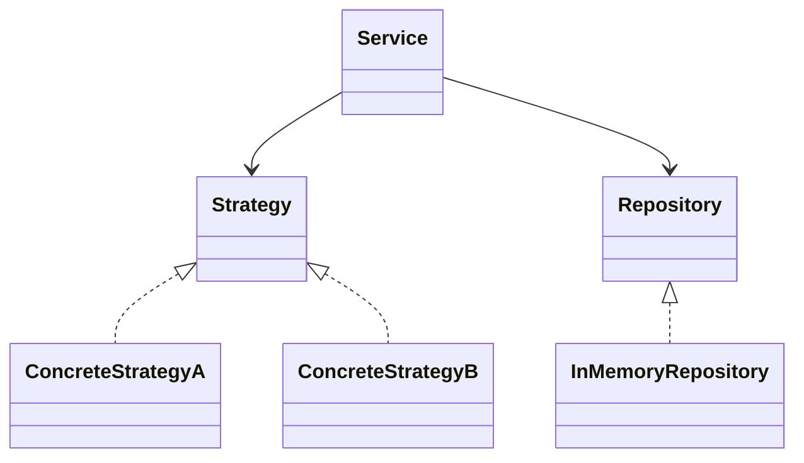

# Coding Challenge — Engineering Guideline

TypeScript coding-challenge project. This guideline MUST be followed for all code in this project.

The global guidelines (`~/.claude/CLAUDE.md`) still apply (pnpm, Simplicity First, Surgical Changes, Goal-Driven Execution).
Where this file is more specific, **this file wins**.

Core pillars:

1. **OOAD** — design before code
2. **SOLID** — every class and interface
3. **GoF design patterns** — applied where they remove real coupling or conditionals
4. **Env-var configuration** — via `.env`, validated with Zod
5. **Strict TypeScript** — zero type errors, no escape hatches
6. **Test-Driven Development** — failing unit test first, then the code
7. **Small tasks, one branch + one PR each** — reviewed before every commit

---

## 1. OOAD Workflow (MANDATORY before coding)

**No non-trivial feature may be implemented until its design is written down.**

```
1. Use cases        → who calls what, with which inputs/outputs
2. Domain model     → nouns = classes/interfaces, verbs = methods
3. Responsibilities → one reason to change per class (SRP)
4. Collaborations   → which abstractions talk to which (DIP)
5. Interfaces first → write the interfaces/types before any concrete class
6. Diagram          → Mermaid class diagram in docs/design/<feature>.md
7. Plan tasks       → split into small, independent tasks, covering NFRs too (see §8.1)
8. Implement (TDD)  → per task: failing test → concrete class → refactor (see §8.2)
```

Design note template (`docs/design/<feature>.md`):

````markdown
# <Feature>

## Use cases

- <Actor> <does X> → <expected result>

## Classes & responsibilities

| Class / Interface | Responsibility | Collaborators |
| ----------------- | -------------- | ------------- |

## Patterns used

- <Pattern> — <why it is needed here>

## Diagram


````

A "trivial" change (rename, typo, single-line fix) does not need a design note.

---

## 2. SOLID Principles

### S — Single Responsibility

Each class has **one reason to change**. Business rules, persistence, input parsing, and configuration are separate classes.

```ts
// ❌ One class that parses input, applies business rules, and writes to storage
// ✅
class PricingCalculator {
  /* business rule only */
}
class InMemoryOrderRepository implements OrderRepository {
  /* storage only */
}
class CsvOrderParser implements OrderParser {
  /* parsing only */
}
```

### O — Open/Closed

Open for extension, closed for modification. Add a new variant by **adding a class**, never by editing a `switch`/`if` chain in existing code.

```ts
export interface DiscountRule {
  apply(total: number): number;
}

// New rule = new file. No edits to the code that uses DiscountRule.
export class PercentageDiscountRule implements DiscountRule {
  /* ... */
}
```

The single place allowed to map config → concrete class is the factory (see §3).

### L — Liskov Substitution

Every implementation MUST honor its interface's full contract. Any implementation must be swappable without callers noticing:

- Same preconditions (never stricter) and postconditions (never weaker)
- Same semantics for edge cases (empty input, missing keys, duplicates)
- Errors are thrown as the same domain error types

Never throw `NotImplementedError` from an interface method — that means the interface is wrong (see ISP).

### I — Interface Segregation

Prefer many small interfaces over one fat one. Clients depend only on what they use.

```ts
export interface Clock {
  now(): number;
}
export interface Reader<T> {
  findById(id: string): Promise<T | null>;
}
export interface Writer<T> {
  save(entity: T): Promise<void>;
}
```

### D — Dependency Inversion

High-level modules depend on **abstractions**, injected via the **constructor**. Domain classes NEVER `new` concrete infrastructure or call `getConfig()` directly.

```ts
export class OrderService {
  constructor(
    private readonly repository: OrderRepository,
    private readonly clock: Clock,
  ) {}
}

// Wiring happens only in the composition root (src/index.ts or src/container.ts)
```

---

## 3. GoF Design Patterns

Use a pattern **only when it removes a real conditional or real coupling** — never speculatively (Simplicity First).
Name the pattern in the class name or a one-line doc comment so readers recognize it.

| Pattern                               | Category   | Use when                                                     | Why                                               |
| ------------------------------------- | ---------- | ------------------------------------------------------------ | ------------------------------------------------- |
| **Strategy**                          | Behavioral | Several interchangeable algorithms/rules                     | Swap behavior without touching the caller (OCP)   |
| **Factory Method / Abstract Factory** | Creational | Config or input selects a concrete class                     | Single place mapping config → concrete classes    |
| **Adapter**                           | Structural | Wrapping third-party clients, I/O, storage                   | Isolate external APIs behind our interfaces       |
| **Decorator**                         | Structural | Logging, metrics, caching, retries                           | Add cross-cutting concerns without modifying core |
| **Chain of Responsibility**           | Behavioral | Ordered validations/handlers that may short-circuit          | Evaluate steps in order, stop on reject           |
| **Observer**                          | Behavioral | Side effects reacting to domain events                       | Decouple notifications from core logic            |
| **Builder**                           | Creational | Optional: complex fluent setup                               | Only if constructor args exceed ~4                |
| **Singleton**                         | Creational | **Only** the validated config — lazy, memoized `getConfig()` | One source of truth for env config                |

Rules:

- **NEVER** use a `static getInstance()` Singleton for services — inject them instead (testability, DIP).
- Factories are the **only** place allowed to contain a `switch` over variant type, and that `switch` MUST be exhaustive (see §6).
- Do not add a pattern "for future flexibility". Introduce it when the second implementation arrives.

---

## 4. OOP Conventions

- **Composition over inheritance.** Inheritance only for true is-a with shared behavior; max depth 1 (abstract base → concrete).
- **Encapsulation:** fields are `private readonly` by default. No public mutable fields. Expose behavior, not state.
- **Constructor injection** for all dependencies. No service locators, no hidden `import` of singletons in domain code.
- **One exported class per file**, file named after the class (`PricingCalculator.ts`).
- **Naming:** no `I` prefix on interfaces (`OrderRepository`, not `IOrderRepository`). Implementations are prefixed by their variant (`InMemoryOrderRepository`, `FileOrderRepository`).
- **Domain errors** extend a single `AppError` base class; never throw strings or plain `Error` from domain code.
- **Immutability:** value objects are `readonly` and created via constructor/factory.

### Folder Layout

```
src/
├── config/          # env.ts (pure parser) + config.ts (lazy getConfig) — the ONLY place that reads process.env
├── interfaces/      # Abstractions (ports) the domain depends on
├── domain/          # Core classes and value objects
├── errors/          # AppError hierarchy
├── factories/       # Factory classes (config → objects)
└── index.ts         # Composition root + public exports
docs/design/         # OOAD design notes
docs/plans/          # Task plans (breakdown + orchestration)
```

Add pattern-specific folders (`strategies/`, `adapters/`, `decorators/`, …) only when the design note calls for them.
Every directory under `src/` that holds code has an `index.ts` barrel (see below).

### Modules: barrels, `@/` alias, tree-shaking

**Barrel file per directory.** Each directory exposes its public API through `index.ts`:

```ts
// src/domain/index.ts
export { PricingCalculator } from './PricingCalculator';
export type { PricingOptions } from './PricingCalculator';
```

- **Explicit named re-exports only.** No `export *` (it hides the public API and risks name clashes). Lint enforces this.
- `export type { … }` for types, so they are erased and never pull in runtime code.
- A barrel re-exports **only side-effect-free modules**. Since no module may have top-level side effects (see below), every module qualifies. Work like loading `.env` happens lazily inside a function (e.g. `getConfig()`), never at import time.
- Barrels contain re-exports only — no logic, no top-level code.

**`@/` alias for cross-directory imports.** `@/*` maps to `src/*` (`tsconfig.json` `paths`; Vitest reads it via `resolve.tsconfigPaths`).

| Import                                              | Rule                                                                      |
| --------------------------------------------------- | ------------------------------------------------------------------------- |
| `import { X } from '@/domain'`                      | ✅ Cross-directory: via the alias, from the barrel                        |
| `import { X } from './X'`                           | ✅ Same directory: relative to the sibling file                           |
| `import { X } from '../domain'`                     | ❌ Parent-relative paths — use `@/`                                       |
| `import { X } from '@/domain/X'`                    | ❌ Deep import past a barrel — import from `@/domain`                     |
| `import { X } from './index'` (inside the same dir) | ❌ Never import your own barrel — causes circular imports                 |
| `import { X } from './X.js'`                        | ❌ JS/TS extensions — code imports are extensionless (Bundler resolution) |

Tests import the unit under test from its sibling file (`./Foo`), not from the barrel.

**Import order.** Imports sit at the top of the file, in this order, with a blank line between groups and alphabetical order (case-insensitive) within each group:

```ts
import { readFileSync } from 'node:fs'; // 1. Node builtins — always with the `node:` protocol

import { z } from 'zod'; // 2. External packages

import { getConfig } from '@/config'; // 3. Internal, via the `@/` alias

import { parseEnv, type Env } from './env'; // 4. Siblings (same directory)
```

- One import statement per module. Merge type and value imports with inline `type` (`{ parseEnv, type Env }`).
- No code between imports; a blank line after the last import.
- Enforced by `eslint-plugin-import-x` (`order`, `first`, `newline-after-import`, `no-duplicates`) and `no-restricted-imports` (bare builtin names such as `'fs'`). Order, blank lines and duplicate imports are auto-fixed by `eslint --fix`, which the pre-commit hook runs. A missing `node:` prefix and the import bans (`..`, deep imports, extensions) must be fixed by hand.

**Tree-shaking must keep working.** Unused exports must be droppable by any bundler importing from a barrel:

- `package.json` declares `"sideEffects": false`, and it must stay **true**: **no module may have observable top-level side effects**. That rules out I/O, reading `process.env`, mutating globals, registration calls, module-level service instances, and imports made only for their side effects (`import 'pkg/register'`). Singletons are lazy (`getConfig()`).
- Pure value construction at module scope is allowed (constants, Zod schemas such as `EnvSchema`). It has no observable effect, so the `sideEffects: false` claim stays true, and bundlers drop it when it is unused.
- Prefer Node built-ins on the `process`/global object over importing a package when a module must stay droppable (e.g. `process.loadEnvFile()` instead of `dotenv`). Bundlers must assume that any import of an external package may have side effects.
- ESM only: no `require`, no `module.exports`, no CommonJS dependencies where an ESM one exists.
- No top-level code with effects in library modules: no registration calls, no mutation of globals, no `new` of services at module scope.
- Prefer named exports; no default exports, and no namespace objects that bundle many functions (`export const utils = { a, b }`), because they defeat tree-shaking.
- `src/treeshaking.test.ts` proves this with esbuild:
  - **Strict probes** (`ignoreAnnotations`: the `sideEffects` flag is ignored) check that modules holding lazy singletons, such as `config.ts`, have no top-level code at all.
  - **Non-strict probes** (`sideEffects` honoured, as in a consumer's bundler) check that importing a barrel without using anything bundles none of its modules.
  - When you add a barrel, add probes for it.

---

## 5. Environment Configuration (.env + Zod)

All runtime configuration comes from environment variables, loaded from `.env` (Node's `process.loadEnvFile()`, no dotenv) and **validated with Zod** on the first `getConfig()` call. To keep fail-fast, the application entry point (e.g. `src/main.ts`, when one exists) MUST call `getConfig()` before doing anything else.

### Rules

- **NEVER** read `process.env` outside `src/config/`. Everything else receives typed config via constructor injection.
- **NEVER** hardcode limits, timeouts, TTLs, URLs, hosts, ports, or secrets.
- `.env.example` is committed and documents **every** variable. `.env` and `.env.*` (except `.env.example`) are gitignored.
- Adding a variable = update the Zod schema **and** `.env.example` in the same change.
- Invalid or missing config **fails fast** at startup with a readable error listing every bad field.
- Tests build config objects directly via `parseEnv({...})` — never assign to `process.env` (see §8.2 for the `getConfig` exception).

### `src/config/env.ts` — pure schema + parser

```ts
import { z } from 'zod';

const EnvSchema = z.object({
  NODE_ENV: z.enum(['development', 'test', 'production']).default('development'),
  LOG_LEVEL: z.enum(['debug', 'info', 'warn', 'error']).default('info'),
  // Example additions:
  // MAX_ITEMS: z.coerce.number().int().positive().default(100),
  // API_URL: z.url().optional(),
});

export type Env = z.infer<typeof EnvSchema>;

// Pure: no process.env access, so tests can import it without side effects.
export function parseEnv(source: Readonly<Record<string, string | undefined>>): Readonly<Env> {
  // Empty values (e.g. `LOG_LEVEL=` in .env) count as unset so defaults apply.
  const defined = Object.fromEntries(Object.entries(source).filter(([, value]) => value !== ''));
  const parsed = EnvSchema.safeParse(defined);
  if (!parsed.success) {
    const issues = parsed.error.issues
      .map((i) => `  - ${i.path.join('.')}: ${i.message}`)
      .join('\n');
    throw new Error(`Invalid environment configuration:\n${issues}`);
  }
  return Object.freeze(parsed.data);
}
```

### `src/config/config.ts` — the lazy singleton

```ts
import { parseEnv, type Env } from './env';

let cached: Readonly<Env> | undefined;

// Singleton (lazy): loads .env and validates on first call, so importing this module has no side effects.
export function getConfig(): Readonly<Env> {
  if (cached === undefined) {
    loadDotEnvIfPresent();
    cached = parseEnv(process.env);
  }
  return cached;
}

// Node's built-in loader; like dotenv, it never overrides variables that are already set.
function loadDotEnvIfPresent(): void {
  try {
    process.loadEnvFile();
  } catch (error: unknown) {
    const missing = error instanceof Error && 'code' in error && error.code === 'ENOENT';
    if (!missing) throw error;
  }
}
```

Both are exported from the `@/config` barrel. Only the composition root calls `getConfig()` and injects the values into constructors.
Tests use `parseEnv({...})`. Tests of `getConfig` itself stub `process.loadEnvFile`, pin variables with `vi.stubEnv`, and use `vi.resetModules()` to get a fresh singleton.

Zod is v4: use `z.url()` (not `z.string().url()`) and `{ error: ... }` (not `{ message: ... }`).
Cross-field rules go in `.refine(..., { error, path })`.

---

## 6. TypeScript Type-Check Restrictions

`pnpm typecheck` (`tsc --noEmit`) MUST pass with **zero errors** before any task is considered done.

### Required `tsconfig.json` compiler options

```json
{
  "compilerOptions": {
    "target": "ES2022",
    "module": "Preserve",
    "moduleResolution": "Bundler",
    "paths": { "@/*": ["./src/*"] },
    "types": ["node"],
    "strict": true,
    "noImplicitAny": true,
    "strictNullChecks": true,
    "noUncheckedIndexedAccess": true,
    "exactOptionalPropertyTypes": true,
    "noImplicitOverride": true,
    "noImplicitReturns": true,
    "noFallthroughCasesInSwitch": true,
    "noUnusedLocals": true,
    "noUnusedParameters": true,
    "useUnknownInCatchVariables": true,
    "forceConsistentCasingInFileNames": true,
    "verbatimModuleSyntax": true,
    "skipLibCheck": true,
    "noEmit": true
  },
  "include": ["src", "vitest.config.ts"]
}
```

These flags MUST NOT be weakened or disabled — not globally, not per file.

Toolchain: Node 24 (`.nvmrc`), ESM (`"type": "module"`, `"sideEffects": false`). Code imports are extensionless and use the `@/` alias (Bundler resolution).
Source is not run directly by Node: `pnpm build` bundles `src/index.ts` with esbuild into `dist/` (dependencies stay external), and Vitest runs the tests.
TypeScript is pinned to `~6.0` because `typescript-eslint` 8 does not support TS 7 yet. Do not upgrade until it does.

### Banned

| Banned                           | Use instead                                                                     |
| -------------------------------- | ------------------------------------------------------------------------------- |
| `any` (explicit or implicit)     | `unknown` + narrowing, generics, or a proper type                               |
| `as` type assertions             | Type guards / Zod parsing. Allowed only at a validated boundary, with a comment |
| Non-null assertion `!`           | Explicit null check or early return                                             |
| `@ts-ignore`, `@ts-nocheck`      | Fix the type. Last resort: `@ts-expect-error <reason>`                          |
| `enum`                           | `as const` object + union type                                                  |
| `Function`, `Object`, `{}` types | Precise function signatures / `Record<string, unknown>`                         |

### Required

- Explicit return types on all exported functions and public methods.
- `readonly` on properties and `ReadonlyArray<T>` / `readonly T[]` for inputs that are not mutated.
- External input (env, HTTP, JSON, files, stdin) typed as `unknown` and narrowed through Zod.
- `import type` for type-only imports (enforced by `verbatimModuleSyntax`).
- Exhaustive `switch` over unions with a `never` check:

```ts
export const Variants = ['a', 'b'] as const;
export type Variant = (typeof Variants)[number];

function assertNever(value: never): never {
  throw new Error(`Unhandled case: ${String(value)}`);
}

// Only inside a factory (see §3)
switch (variant) {
  case 'a':
    return new VariantA(deps);
  case 'b':
    return new VariantB(deps);
  default:
    return assertNever(variant);
}
```

### ESLint

- Extend `@typescript-eslint/strict-type-checked` and `@typescript-eslint/stylistic-type-checked`.
- `@typescript-eslint/no-explicit-any: error`
- `@typescript-eslint/explicit-function-return-type: error`
- `@typescript-eslint/switch-exhaustiveness-check: error`
- `no-restricted-properties` forbids `process.env` outside `src/config/`.
- `no-restricted-syntax` forbids `enum` declarations and `export *`.
- `no-restricted-imports` forbids parent-relative imports (`..`, `../`), deep imports past a barrel (`@/<dir>/<file>`), JS/TS file extensions (`.js`, `.ts`, `.mjs`, …; assets such as `.json` keep theirs), and static imports of builtins without the `node:` protocol.
- `eslint-plugin-import-x` enforces the import order (see §4 "Import order").
- `src/lint-rules.test.ts` lints sample snippets to prove that the import rules fire. Extend it when you add or change a rule.
- `eslint-config-prettier` is applied **last** so ESLint never fights Prettier over formatting.

### Scripts (`package.json`)

```json
{
  "scripts": {
    "prepare": "husky",
    "typecheck": "tsc --noEmit",
    "lint": "eslint .",
    "format": "prettier --write .",
    "format:check": "prettier --check .",
    "test": "vitest run",
    "test:watch": "vitest",
    "build": "esbuild src/index.ts --bundle --platform=node --format=esm --packages=external --outdir=dist",
    "check": "pnpm format:check && pnpm typecheck && pnpm lint && pnpm test",
    "check:examples": "pnpm build && pnpm -r --filter './examples/**' check",
    "check:all": "pnpm check && pnpm check:examples"
  }
}
```

---

## 7. Formatting & Pre-commit Hooks

### Package manager

- **pnpm only** — pinned via `"packageManager"` in `package.json`. Never use `npm`/`yarn`, never commit `package-lock.json` or `yarn.lock`.
- Install: `pnpm install` (this also runs `prepare` → installs the Git hooks).
- Add deps: `pnpm add <pkg>` / `pnpm add -D <pkg>`.

### Prettier

- Config: `.prettierrc.json` (`singleQuote`, `trailingComma: "all"`, `printWidth: 100`). Ignore list: `.prettierignore`.
- Prettier owns formatting; ESLint owns correctness. Do not add stylistic ESLint rules that duplicate Prettier.

### Pre-commit hook (Husky + lint-staged)

`.husky/pre-commit` runs on every `git commit`:

```sh
pnpm exec lint-staged   # staged *.ts/*.js → eslint --fix --max-warnings=0, then prettier --write
                        # staged *.json/*.md/*.yml → prettier --write
pnpm typecheck          # whole project — types are cross-file, so staged-only is not enough
```

Rules:

- **NEVER** bypass the hook with `git commit --no-verify` (or `-n`). If the hook fails, fix the cause.
- **NEVER** weaken the hook or the `lint-staged` config to make a commit pass.
- Tests are not in the hook (keep commits fast); `pnpm check` runs them and is required by the Definition of Done.

---

## 8. Development Workflow (MANDATORY)

Every change follows: **plan → branch → TDD → review → commit → PR**.

### 8.1 Task planning & orchestration

Before coding a feature, break it down and write the plan to `docs/plans/<feature>.md`.

Each task MUST be:

- **Small** — one concern, reviewable in one sitting (aim for < ~300 changed lines incl. tests).
- **Logically independent** — has its own tests and leaves `main` green when merged alone.
- **Vertical, not layered by file type** — a task delivers a working, tested unit (e.g. "`PricingCalculator` + tests"), not "all interfaces" then "all tests".
- **One branch, one PR.**

Then **orchestrate**: record dependencies between tasks and derive the execution order.

- Tasks with no dependencies between them may run in parallel (separate branches off `main`).
- A dependent task starts only after its dependency's PR is merged; if it must start earlier, branch from the dependency's branch (stacked PR), open it as a **draft**, and retarget to `main` once the dependency merges (see §8.6).
- Typical order: design note → interfaces/value objects → one implementation per task → composition-root wiring.

**Keep the plan's status current.** The plan is the single place to see progress, so each task updates its own row:

- The task's PR sets its row in `docs/plans/<feature>.md` to `done`, in the same PR, so merging the PR marks the task done. A PR closed without merging leaves the row unchanged.
- The same PR sets an NFR row to `done` when this task completes that row's criterion (it is the last task listed for it).
- Only touch your own task's rows. If another task's row is out of date, fix it in a separate PR.
- Status values: `pending` → `done` for tasks; `planned` → `done`, or `deferred — <reason>`, for NFRs.

**Non-functional requirements (NFRs).** The plan MUST also cover these NFRs, not only the functional behavior:

| NFR                 | Questions the plan must answer                                                                                                                                 |
| ------------------- | -------------------------------------------------------------------------------------------------------------------------------------------------------------- |
| **Scalability**     | How does it behave as load, data size, or instance count grows? What is the time/memory cost per operation? Any shared state?                                  |
| **Maintainability** | Can a new variant be added without editing existing code (OCP)? Are the seams (interfaces) in the right place?                                                 |
| **Readability**     | Are names, file sizes, and the public API easy to follow? Is the "why" of non-obvious decisions written down?                                                  |
| **Security**        | What input is untrusted and where is it validated? Can it be abused (DoS, injection, key collisions, unbounded growth)? Are secrets kept out of code and logs? |
| **Observability**   | How will an operator know it works or fails in production (logs, metrics, events)? What is logged, and at which level?                                         |

Rules:

- For each NFR, write a **concrete, verifiable criterion** (e.g. "memory per consumer is O(limit); idle consumers are evicted — tested"), or state explicitly why it does not apply. "N/A" with no reason is not accepted.
- Each criterion is owned by a task. Either it fits in a task that already exists (and is listed in that task's details and tests), or it gets its own task.
- An NFR that is designed but deliberately not built (e.g. a scaling path for a later phase) is marked **Deferred**, with the reason and where it is documented.

Plan template (`docs/plans/<feature>.md`):

```markdown
# <Feature> — Task Plan

| #   | Task                               | Branch                    | Depends on | Status  |
| --- | ---------------------------------- | ------------------------- | ---------- | ------- |
| 1   | Design note + interfaces           | docs/<feature>-design     | —          | pending |
| 2   | `ConcreteStrategyA` + tests        | feat/<feature>-strategy-a | 1          | pending |
| 3   | `ConcreteStrategyB` + tests        | feat/<feature>-strategy-b | 1          | pending |
| 4   | Wire in factory + composition root | feat/<feature>-wiring     | 2, 3       | pending |

Parallel: 2 ∥ 3. Sequential: 1 → (2, 3) → 4.

## Non-functional requirements

| NFR             | Criterion (verifiable)                      | Task(s) | Status              |
| --------------- | ------------------------------------------- | ------- | ------------------- |
| Scalability     | <e.g. O(1) per call; no unbounded growth>   | 2, 3    | planned             |
| Maintainability | <e.g. new strategy = new class, no edits>   | 1, 4    | planned             |
| Readability     | <e.g. public API documented in README>      | 4       | planned             |
| Security        | <e.g. input validated with Zod at the edge> | 2       | planned             |
| Observability   | <e.g. denials emit a domain event>          | 4       | deferred — <reason> |
```

### 8.2 Test-Driven Development

**No production code without a failing test that demands it.** Red → Green → Refactor, per behavior:

1. **Red** — write the unit test first. Run `pnpm test` and confirm it fails **for the expected reason** (assertion failure, not a typo or import error).
2. **Green** — write the minimum production code to make it pass.
3. **Refactor** — clean up with all tests green; no behavior change.
4. Repeat for the next behavior/edge case.

Rules:

- Bug fix = first a test that reproduces the bug (red), then the fix.
- Tests live next to the source: `Foo.ts` → `Foo.test.ts` (Vitest).
- Unit tests use hand-written fakes of injected interfaces (DIP makes this trivial) — no real network, filesystem, or clock. Inject a `Clock` instead of calling `Date.now()`.
- Exception: **tooling tests** at the root of `src/` (`treeshaking.test.ts`, `lint-rules.test.ts`) check the build and lint configuration. They may read the repo through esbuild or ESLint, but never write to it or use the network.
- Cover the contract: happy path, edge cases (empty, boundary, duplicates), and every domain error thrown.
- Never assign to `process.env` in tests; build config objects via `parseEnv({...})`. Only `getConfig` tests may pin variables, and only with `vi.stubEnv` + `vi.unstubAllEnvs()`.
- Never delete, skip (`it.skip`, `.only`), or weaken a test to make it pass.
- The pre-commit hook type-checks, so Red and Green may land in the same commit; the PR description MUST include the Red output as evidence.

### 8.3 Branching

- **Never commit directly to `main`.** Every task gets its own feature branch, created from an up-to-date `main`:
  ```sh
  git switch main && git pull && git switch -c feat/<short-kebab-name>
  ```
- Branch prefixes: `feat/`, `fix/`, `refactor/`, `test/`, `docs/`, `chore/`.
- Commit messages follow Conventional Commits: `feat: add PricingCalculator`, `test: cover empty cart`, `fix: ...`.
- Stay in scope: unrelated changes go in a separate task/branch.

### 8.4 Code review before every commit

Before each commit, review the staged diff (e.g. `/code-review`, or a review subagent) against this guideline, then classify findings:

| Severity     | Examples                                                                                                                                | Action                                |
| ------------ | --------------------------------------------------------------------------------------------------------------------------------------- | ------------------------------------- |
| **Critical** | Bugs, wrong results, security issues, broken contract (LSP), banned constructs (`any`, `as`, `!`, `enum`), `process.env` outside config | **MUST fix before commit**            |
| **Medium**   | Missing tests or edge cases, SOLID/DIP violations, hardcoded config, poor error handling, misleading names                              | **MUST fix before commit**            |
| **Low**      | Nits, minor naming/readability preferences                                                                                              | Fix, or list in the PR as a follow-up |

After fixing, re-run `pnpm check` and re-review until no Critical/Medium findings remain.

### 8.5 Pull requests

- Push the branch and open a PR against `main` for review:
  ```sh
  git push -u origin <branch>
  gh pr create --base main --title "<conventional title>" --body-file <body.md>
  ```
- **One task per PR.** Never merge your own PR — it waits for human review and approval.
- PR description template:

  ```markdown
  ## Summary

  <what and why, 1–3 bullets> — Task #<n> in docs/plans/<feature>.md

  ## TDD evidence

  - Red: <failing test output>
  - Green: <passing `pnpm check` output>

  ## Code review

  - Critical/Medium found & fixed: <list or "none">
  - Low / follow-ups: <list or "none">
  ```

- Address review comments with new commits on the same branch (each one reviewed per §8.4).

### 8.6 Keep the branch up to date before merge

A PR is merged into `main` **only when its branch contains the latest `main`**. Its diff must show only its own task.

1. Right before asking for the merge (and whenever `main` moves while the PR is open), rebase onto the latest `main`:
   ```sh
   git fetch origin
   git rebase origin/main          # fix conflicts, then `git rebase --continue`
   pnpm check                      # re-verify on top of the new main
   git push --force-with-lease     # never plain --force
   ```
2. Check that the PR's "Files changed" lists only this task's files. Extra files mean the branch is based on something that isn't in `main` yet.
3. Force-push only your own feature branch, never `main` or a branch someone else is working on.

**Stacked PRs.** A PR based on another feature branch is never merged into that branch. To make that impossible,
a stacked PR is **always opened as a draft** (`gh pr create --draft --base <parent-branch>`), and its description
starts with `Stacked on #<parent> — do not merge until retargeted to main`. GitHub can't merge a draft, so it can't
land in the parent branch by mistake. When the parent merges into `main`:

1. Retarget the child PR to `main` (`gh pr edit <n> --base main`).
2. Rebase the child onto `origin/main` (step 1 above), so its diff shows only its own commits.
3. Mark it ready for review (`gh pr ready <n>`). Only then merge it.

A PR that targets anything other than `main` must stay a draft. If one is found ready for review, convert it back
(`gh pr ready <n> --undo`).

Merging a child into its parent branch after the parent has merged leaves the child's work outside `main`.

**Repository setting.** Enable branch protection on `main` with "Require branches to be up to date before merging" and "Automatically delete head branches". GitHub then blocks out-of-date merges and retargets stacked PRs to `main` by itself.

---

## 9. Definition of Done

A task is complete only when every item holds:

- [ ] Design note exists in `docs/design/` (non-trivial features)
- [ ] Each new class has a single responsibility; dependencies are injected interfaces
- [ ] Any GoF pattern used is named and justified in the design note
- [ ] No `process.env` access outside `src/config/`; no hardcoded config values
- [ ] Zod schema and `.env.example` updated for any new variable
- [ ] No `any`, `as` (outside validated boundaries), `!`, `@ts-ignore`, or `enum`
- [ ] New directories have an `index.ts` barrel; cross-directory imports use `@/<dir>`; imports follow the §4 order; no new top-level side effects (tree-shaking test passes)
- [ ] `pnpm check` passes (format + typecheck + lint + test), with output shown as evidence
- [ ] If the task touches `examples/` (or the library's public API), `pnpm check:examples` also passes; CI runs `pnpm check:all`
- [ ] Task is listed in `docs/plans/<feature>.md` and is small and logically independent
- [ ] The NFR criteria this task owns (see §8.1) are met and tested, or explicitly marked Deferred in the plan
- [ ] Tests were written first and seen failing (Red output in the PR)
- [ ] Work is on a feature branch, never directly on `main`
- [ ] Code review run before commit; all Critical and Medium findings fixed
- [ ] Commit went through the pre-commit hook (no `--no-verify`)
- [ ] PR raised against `main` with the template filled in; not self-merged (a stacked PR stays a draft until retargeted to `main`, §8.6)
- [ ] The PR sets this task's row (and any NFR rows it completes) to `done` in `docs/plans/<feature>.md` (§8.1)
- [ ] Before merge, the branch is rebased on the latest `main`, `pnpm check` passes, and the PR diff shows only this task (§8.6)
