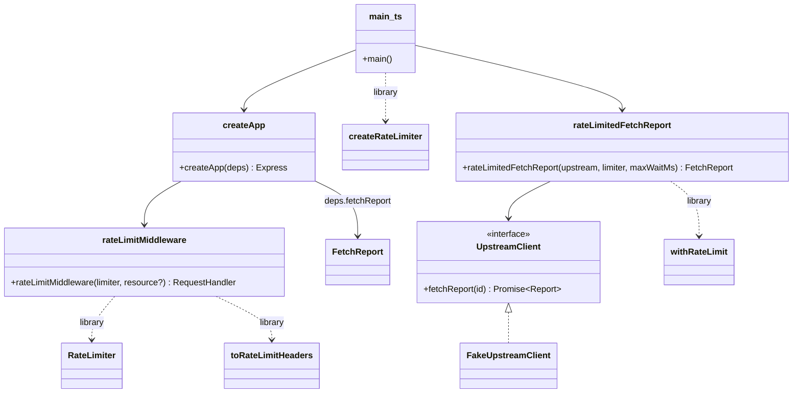

# Express E2E Example

An isolated Express server under `examples/express-server/` that uses the rate limiter the way a real consumer
would, plus end-to-end tests that exercise every rate-limiting scenario over real HTTP.

## Decisions

| Question                 | Decision                                                                                                                                                                                                                                                                                |
| ------------------------ | --------------------------------------------------------------------------------------------------------------------------------------------------------------------------------------------------------------------------------------------------------------------------------------- |
| Isolation                | Separate pnpm workspace package with its own `package.json`, `tsconfig.json`, ESLint/Vitest config and dependencies.                                                                                                                                                                    |
| How it uses the library  | `"coding-challenge-loic-wong": "workspace:*"`, imports only the public API (the built `dist/`). All of the example's packages, Express included, are devDependencies: it is a local-run example, never installed for production.                                                        |
| How tests run the server | In-process: `createApp(...)` started with `app.listen(0, '127.0.0.1')` (ephemeral port), called with `fetch`. Real HTTP and headers. `main.e2e.test.ts` also runs the built `dist/main.js` with `PORT=0`.                                                                               |
| Time                     | Real time with short windows (e.g. 300 ms) configured by the tests. Assertions allow a small timing tolerance.                                                                                                                                                                          |
| Part of `pnpm check`     | No: `pnpm check` stays library-only and fast. `pnpm check:examples` builds the library and checks the example; `pnpm check:all` runs both, for CI and before merging changes that touch `examples/`.                                                                                    |
| Running it locally       | `pnpm example:start` builds and runs the server (`node dist/main.js`); `pnpm example:dev` restarts on change (`tsx watch`). `pnpm example:demo` is a self-contained bash + curl demo: it starts the server, runs the scenarios with PASS/FAIL, stops it, and exits non-zero on failure. |

## Prerequisite: the library must be consumable as a package

Today the root package has no `exports`/`types`, `pnpm build` emits JavaScript only, and declarations emitted by
`tsc` would keep the internal `@/…` aliases, which a consumer can't resolve. The library therefore needs:

- `exports` (`types` + `import`) and `files` pointing at `dist/`.
- A bundled `dist/index.d.ts` with no `@/` imports (one declaration bundle, generated in `pnpm build`).
- A test proving it: the built declaration file contains no `@/` specifiers and exposes the public API.

## Use cases

- **API client** calls `GET /api/resource` with `X-Consumer-Id: alice` → `200` with `RateLimit-*` headers while under
  the default limit; `429` with `Retry-After` and `RateLimit-*` once over it.
- **API client** omits or sends an invalid `X-Consumer-Id` → `400` (no quota is used).
- **API client** calls `GET /api/search` → a stricter per-resource limit applies (extension a).
- **Partner client** (`X-Consumer-Id: partner-acme`) → a higher per-consumer limit, and a resource+consumer override on
  `/api/search`.
- **API client** calls `GET /api/report` → the server calls a (fake, in-process) upstream through `withRateLimit`, so a
  burst of report requests all succeed but upstream calls are spread out to respect the upstream's quota; when the
  wait would exceed the configured cap, the server returns `503` with `Retry-After` (via `RateLimitTimeoutError`).
- **Operator** starts the server with invalid limits → startup fails fast (config error naming the field, exit 1).
- **Operator** — the limiter's store fails → the request gets `503` (fail-closed), never an unthrottled `200`.
- **Developer** runs `pnpm example:start` and tries the endpoints with `curl`, or runs `pnpm example:demo` to see
  every scenario play out in the terminal with PASS/FAIL.

## Classes & responsibilities

| Class / function                          | Responsibility                                                                                                           | Collaborators                            |
| ----------------------------------------- | ------------------------------------------------------------------------------------------------------------------------ | ---------------------------------------- |
| `createApp(deps)`                         | Build the Express app from injected dependencies (limiter, `FetchReport`); no `listen`, no env access.                   | `RateLimiter`, `FetchReport`, middleware |
| `rateLimitMiddleware(limiter, resource?)` | Read and validate the consumer ID, call `limiter.check`, set headers, `429` on deny, `503` on error.                     | `RateLimiter`, `toRateLimitHeaders`      |
| `consumerIdFrom(req)`                     | Extract and validate `X-Consumer-Id` (non-empty, bounded length, safe charset).                                          | none                                     |
| `UpstreamClient` (interface)              | The call `/api/report` makes to an upstream service.                                                                     | none                                     |
| `rateLimitedFetchReport(...)`             | Wrap `UpstreamClient.fetchReport` with `withRateLimit` and `maxWaitMs`; returns a `FetchReport`.                         | `UpstreamClient`, `withRateLimit`        |
| `reportHandler(fetchReport)`              | `GET /api/report/:id`: validate the id, `200` / `400` / `502`, `503` + `Retry-After` on timeout.                         | `FetchReport`                            |
| `FakeUpstreamClient`                      | In-process upstream used by the example and tests (returns data, records call times).                                    | none                                     |
| `loadExampleConfig(env)`                  | Zod-validated example config (`PORT` 0–65535, default limit/window, policies, upstream quota + cap).                     | `zod`                                    |
| `main.ts` (entry)                         | Composition root: load `.env` (env wins), config (fail fast), limiters, `rateLimitedFetchReport`, `createApp`, `listen`. | all of the above, `createRateLimiter`    |

## Patterns used

- **Middleware (Chain of Responsibility)**: Express middleware validates the consumer, then rate-limits, then hands
  over to the route; each step can stop the chain (`400`, `429`, `503`).
- **Decorator**: `withRateLimit` (via `rateLimitedFetchReport`) wraps the upstream call without changing it.
- **Dependency injection / Factory**: `createApp(deps)` takes the limiter and a `FetchReport` function (built by
  `rateLimitedFetchReport` in `main.ts`); only `main.ts` reads env (and passes it to the pure `loadExampleConfig`) and
  wires concrete objects, so tests build the app with short-window policies.

## Scenarios covered by the E2E tests

| #   | Scenario                                                                                                  |
| --- | --------------------------------------------------------------------------------------------------------- |
| 1   | Allowed requests return `200` with `RateLimit-Limit/Remaining/Reset`; `remaining` counts down to `0`.     |
| 2   | The request that reaches `remaining: 0` is still `200` with no `Retry-After`.                             |
| 3   | The next request is `429` with `Retry-After` (seconds, rounded up) and `RateLimit-Remaining: 0`.          |
| 4   | After waiting `Retry-After`/window, requests are allowed again (real time).                               |
| 5   | Sliding window: requests spread across the window free up one by one, not all at a boundary.              |
| 6   | Denied requests don't extend the wait (hammering while blocked).                                          |
| 7   | Consumers are isolated; resources are isolated.                                                           |
| 8   | A concurrent burst over HTTP allows exactly `limit` and rejects the rest (atomicity).                     |
| 9   | Missing/invalid `X-Consumer-Id` → `400`, no quota used.                                                   |
| 10  | Per-resource policy on `/api/search`; per-consumer policy for the partner; override for partner + search. |
| 11  | `/api/report`: a burst of requests all succeed while upstream calls respect the upstream limit.           |
| 12  | `/api/report`: when the wait would exceed the cap → `503` with `Retry-After`.                             |
| 13  | Store failure → `503` (fail-closed).                                                                      |
| 14  | Invalid limits → the policy resolver (`InvalidArgumentError`) / config fails fast; the server exits 1.    |

## Non-functional requirements

| NFR             | Criterion (verifiable)                                                                                                                          |
| --------------- | ----------------------------------------------------------------------------------------------------------------------------------------------- |
| Maintainability | The example imports only the library's public API (package exports); Express is not a dependency of the library.                                |
| Readability     | Small files (app, middleware, routes, config, entry); the example has its own README with run/test instructions.                                |
| Security        | The consumer ID is untrusted input: validated (length/charset) → `400`. Store errors fail closed (`503`).                                       |
| Reliability     | E2E tests use short real windows with tolerances; the suite runs in a few seconds and is not flaky (run 5× in CI-like conditions before merge). |
| Observability   | Every response carries `RateLimit-*` headers; `429`/`503` bodies are JSON with a reason. Logging stays deferred (as in the library).            |
| Scalability     | In-memory store is per process — documented in the example README (see the library's HA design).                                                |

## Diagram

