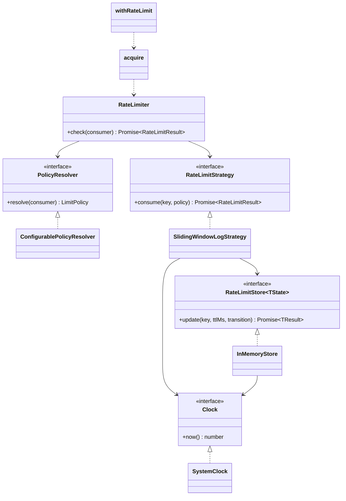

# Rate Limiter

Library function `rateLimit(consumer)` that decides whether an identified resource consumer may proceed.
Default policy: **at most 10 requests in any 1-second span per consumer**. When denied, the result says how many
milliseconds to wait before retrying.

## Scope

| Item                                                           | Status                                                                    |
| -------------------------------------------------------------- | ------------------------------------------------------------------------- |
| `rateLimit(consumer)` with 10 req/s per consumer               | Built                                                                     |
| Test suite demonstrating correctness                           | Built                                                                     |
| (a) Configurable limit per resource and per consumer           | Built (`ConfigurablePolicyResolver`)                                      |
| (b) Highly available web application                           | Designed and documented (README). The store interface is ready for Redis. |
| IETF draft headers `RateLimit-Limit` / `-Remaining` / `-Reset` | Built (`toRateLimitHeaders`)                                              |
| `Retry-After` header on deny (RFC 9110)                        | Built                                                                     |
| Client-side waiting, inspired by tenacity / urllib3 `Retry`    | Built (`acquire`)                                                         |
| Function wrapper, inspired by p-limit `limit(fn)`              | Built (`withRateLimit`)                                                   |

## Use cases

- **Service** calls `rateLimit({ consumerId })` → gets `allowed: true` and remaining quota, or `allowed: false` plus `retryAfterMs`.
- **Service** calls `rateLimit({ consumerId, resource })` → limit is resolved for that resource/consumer pair.
- **HTTP handler** calls `toRateLimitHeaders(result)` → sets `RateLimit-*` headers, plus `Retry-After` with a 429.
- **Caller that prefers waiting** calls `acquire(limiter, consumer, { maxWaitMs, signal })` → resolves once allowed, or throws `RateLimitTimeoutError` / the abort reason.
- **Caller wrapping an API client** calls `withRateLimit(limiter, consumer, fn)` → every call to the wrapped function is throttled.

## Public API

```ts
type Consumer = { readonly consumerId: string; readonly resource?: string }; // resource defaults to "default"
type LimitPolicy = { readonly limit: number; readonly windowMs: number };
type RateLimitResult =
  | { allowed: true;  limit: number; remaining: number; resetMs: number; retryAfterMs: 0 }
  | { allowed: false; limit: number; remaining: 0;      resetMs: number; retryAfterMs: number };

rateLimit(consumer): Promise<RateLimitResult>                 // default instance: env-configured (10 / 1000 ms)
createRateLimiter(options): RateLimiter                       // factory: defaultPolicy or policies, + clock / store
toRateLimitHeaders(result): Record<string, string>            // IETF draft headers + Retry-After on deny
acquire(limiter, consumer, options?): Promise<RateLimitResult> // waits instead of rejecting
withRateLimit(limiter, consumer, fn, options?): (...args) => Promise<TResult> // throttled wrapper
```

The API is async even though the in-memory store is synchronous. A shared store such as Redis (extension b) can then be
swapped in without breaking callers.

## Classes and responsibilities

| Class / Interface                          | Responsibility                                                                     | Collaborators                         |
| ------------------------------------------ | ---------------------------------------------------------------------------------- | ------------------------------------- |
| `Clock` / `SystemClock`                    | Current time in ms                                                                 | Strategy, store                       |
| `RateLimitStore<TState>`                   | Atomic read-modify-write of per-key state with TTL                                 | Strategy                              |
| `InMemoryStore<TState>`                    | `Map`-backed store with lazy expiry and periodic sweep                             | `Clock`                               |
| `RateLimitStrategy`                        | Decide allow/deny for a key under a policy                                         | Store, `Clock`                        |
| `SlidingWindowLogStrategy`                 | Timestamp-log algorithm with an exact wait time                                    | Store, `Clock`                        |
| `PolicyResolver`                           | Map a consumer to a `LimitPolicy`                                                  | none                                  |
| `ConfigurablePolicyResolver`               | Most-specific match: resource+consumer, then consumer, then resource, then default | none                                  |
| `RateLimiter`                              | Resolve the policy, build the key, delegate to the strategy                        | `PolicyResolver`, `RateLimitStrategy` |
| `createRateLimiter`                        | Default policy or resolver (+ clock/store) → `RateLimiter`; never reads config     | All of the above                      |
| `toRateLimitHeaders`                       | Translate a result into HTTP headers                                               | none                                  |
| `acquire` / `withRateLimit`                | Client-side wait-and-retry with caps, jitter and abort                             | `RateLimiter`                         |
| `RateLimitError` / `RateLimitTimeoutError` | Domain errors                                                                      | none                                  |

## Algorithm: sliding window log

The state for each key is a list of the timestamps of allowed requests.

1. Drop timestamps `<= now - windowMs`.
2. If `count < limit`, record `now` and allow. `remaining = limit - count - 1`.
3. Otherwise deny with `retryAfterMs = oldest + windowMs - now`. **Denied requests are not recorded**, so clients that
   keep retrying don't push their own wait further out.
4. `resetMs` is the time until the oldest timestamp leaves the window, i.e. when at least one unit frees up (0 when the
   log is empty).

Why this algorithm and not fixed window or token bucket is explained in the README ("Algorithm choice").

## Patterns used

- **Strategy**: `RateLimitStrategy`. New algorithms are added as new classes, and `RateLimiter` doesn't change (OCP).
- **Adapter**: `RateLimitStore` over `Map` today, and over Redis for the HA design.
- **Factory**: `createRateLimiter` is the single place that picks concrete classes. It never reads config.
- **Singleton** (config only): the lazy, memoized `getConfig()` in `src/config/config.ts`.
- **Decorator-style wrapper**: `withRateLimit` adds throttling around any sync or async function without changing it.

## Key and policy resolution

- Store key: `JSON.stringify([resource, consumerId])`. This can't collide, whatever characters the IDs contain.
- `ConfigurablePolicyResolver` options: `{ default, resources?: Record<resource, LimitPolicy>, consumers?: Record<consumerId, LimitPolicy>, overrides?: Record<resource, Record<consumerId, LimitPolicy>> }`.

## Configuration (env, validated with Zod)

| Variable                  | Default | Meaning                     |
| ------------------------- | ------- | --------------------------- |
| `RATE_LIMIT_MAX_REQUESTS` | `10`    | Default limit per window    |
| `RATE_LIMIT_WINDOW_MS`    | `1000`  | Default window length in ms |

## Test plan

Time is controlled with `vi.useFakeTimers()`, which also drives `SystemClock` (`Date.now`) and `setTimeout`.

- **Strategy**:
  - A burst of 10 is allowed. The 11th is denied with an exact `retryAfterMs`, and is allowed again after that wait.
  - Sliding window: 5 at t=0 and 5 at t=500. At t=999 a request is denied. At t=1000 exactly 5 slots free up.
  - Denied requests don't use up quota.
  - Consumers are isolated, and so are resources.
  - **Invariant**: seeded random arrivals, and no 1-second span contains more than 10 allowed requests.
- **InMemoryStore**: TTL expiry and sweep eviction.
- **ConfigurablePolicyResolver**: precedence order.
- **Headers**: values, rounding up, and `Retry-After` only when denied.
- **acquire**:
  - Waits, then succeeds.
  - `maxWaitMs` and `maxAttempts` raise a timeout.
  - Abort works.
  - Jitter never makes it retry early.
- **withRateLimit**: arguments and return value pass through. A burst of 15 runs 10 immediately and 5 after the window.
- **Default `rateLimit`**: 10 allowed, then the 11th is denied with `0 < retryAfterMs <= 1000`.

## High availability (extension b, documented in README)

- `RedisStore` implements the strategy atomically with a Lua script (`ZREMRANGEBYSCORE`, `ZCARD`, `ZADD`, `PEXPIRE`),
  using Redis `TIME` so app servers' clocks don't need to agree.
- Use hash tags for Redis Cluster key placement.
- Decide explicitly between fail-open and fail-closed when Redis is unavailable, and allow for replication lag.
- An optional local pre-check, and per-node budgets as a degraded mode.

## Diagram



## Adaptations for this repository

The design above was copied from the `rate-limit` repo. These changes make it fit this repo's `CLAUDE.md`:

- **Config singleton**: there is no frozen `config` object. `getConfig()` (lazy, in `@/config`) is the singleton.
  `createRateLimiter` takes the default `LimitPolicy` as an option and never reads config. Only the default
  `rateLimit()` in the composition root calls `getConfig()`, on first use. No limiter exists at module scope.
  Its options are a union: exactly one of `defaultPolicy` (a `LimitPolicy` for everyone) or `policies` (a
  `PolicyResolver`), so a policy can never be passed and then silently ignored.
- **Errors**: `RateLimitError` extends a new `AppError` base in `src/errors/`. `RateLimitTimeoutError` extends
  `RateLimitError`.
- **Modules**: every new directory (`strategies/`, `stores/`, `policies/`, `http/`, `client/`, `testing/`) gets an
  `index.ts` barrel and tree-shaking probes. Imports use `@/<dir>` and are extensionless. `FakeClock` (in `testing/`)
  is not re-exported from `src/index.ts`.
- **Store contract**: the real signature is `update(key, ttlMs, transition)`. `transition(previous)` returns
  `{ state, result }`, and `update` resolves to `result`. No other update of the same key may interleave.
- **Test clocks**: strategy, store, limiter and resolver tests inject `FakeClock`. `vi.useFakeTimers()` is used only
  where `setTimeout` is involved (`acquire`, `withRateLimit`).
- **`RateLimiter` gets its own unit test** (key building, `resource` default, delegation), using fake collaborators.
- **README**: the "Algorithm choice" and "High availability" sections are written in the final task.
